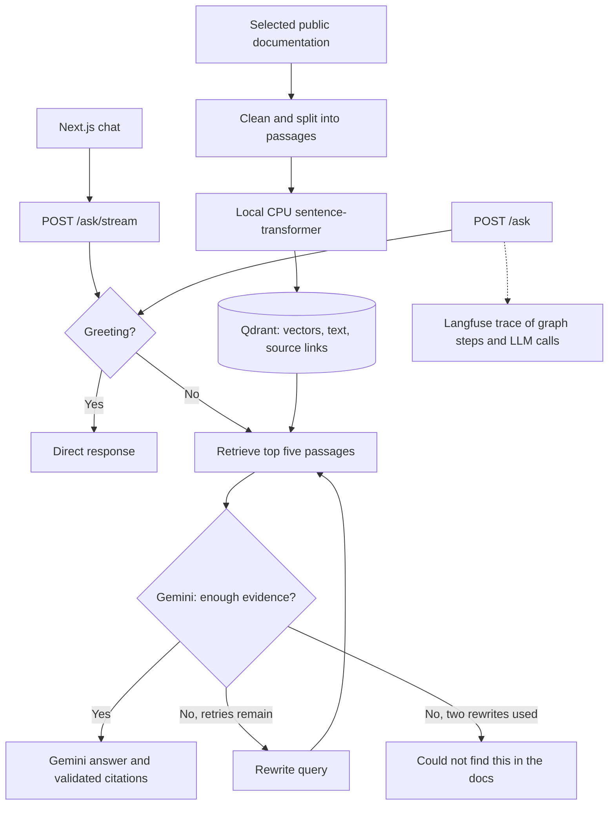

# DocsPilot

[](https://github.com/shezafarooq/docsPilot-RAG/actions/workflows/ci.yml)

A technical documentation Q&A agent with source citations.

Ask a technical question, retrieve evidence from selected Docker and FastAPI docs,
and receive a Gemini answer with source passages and links. If the evidence is weak,
the LangGraph workflow rewrites the search query up to twice before declining to answer.

## Architecture



## Current stage

Local ingestion and semantic retrieval over 11 selected Docker and FastAPI documentation
pages or sections, with Gemini answers, source citations, a corrective LangGraph
workflow, optional Langfuse tracing, a Next.js chat interface, and GitHub Actions CI.
Persistent SQLite conversation checkpoints are enabled; EC2 deployment is a later milestone.
The chat now streams real graph progress and citation-checked answer sections.

## Local setup

Prerequisites: Docker with Docker Compose. Host Python is optional when using Docker.

1. Copy `.env.example` to `.env` if `.env` does not already exist.
2. Add your Gemini API key to `.env` when ready. Keys are not needed for this setup check.
3. Start the services:

   ```bash
   docker compose up -d --build
   docker compose ps
   ```

4. Open:
   - Chat interface: http://localhost:3001
   - API liveness: http://localhost:8000/health
   - Interactive API docs: http://localhost:8000/docs
   - Qdrant dashboard: http://localhost:6333/dashboard

The health endpoint checks only that the API process responds. It does not verify
Gemini access, document ingestion, or Qdrant readiness.

## Credentials

Create a Gemini key at https://aistudio.google.com/apikey and paste it into
`GEMINI_API_KEY` in `.env`. Use a project on the free tier for this project.
Set `GEMINI_MODEL` to a model ID available to your project and verify it before use.

For tracing, copy the public key, secret key, and base URL from your Langfuse
project settings into `.env`. Omit them to run without tracing.

After setting credentials and a Gemini model ID, rebuild/recreate the API so it
receives the updated environment, then verify access:

```bash
docker compose up -d --build api
docker compose exec -T api python -m app.verify_access
```

This sends one small Gemini generation request and checks Langfuse project
authentication. It does not create a Langfuse trace or prove an account's billing
tier. The command reports failures without printing keys or raw provider errors.

Keep actual keys in `.env`. This file is ignored by Git and excluded from Docker builds.
Qdrant runs locally in Docker; no Qdrant account or separate installation is required.

## Container networking and storage

Inside Compose, Python connects to Qdrant using `http://qdrant:6333`.
Python running directly on the host would use `http://localhost:6333`.
All published ports are bound to the local computer only.
The Next.js server forwards browser requests from `/api/chat` to `http://api:8000/ask`;
the browser never needs the internal Compose service address or backend credentials.
Qdrant data lives in the `qdrant_data` named volume and survives container recreation.

```bash
docker compose logs --tail=50
docker compose down
```

`docker compose down` preserves the data volume. Adding `-v` deletes it.
The Qdrant image is pinned to the downloaded image digest for repeatable setup.

## Download and index documentation

```bash
docker compose up -d --build
docker compose exec -T api python -m app.ingest
```

The first build installs CPU-only PyTorch and Sentence Transformers. The first
ingestion downloads the embedding model. These downloads can take several minutes;
no GPU or paid embedding API is used.
Question answering loads only cached model files and makes no Hugging Face network
checks. If the model cache is missing, run ingestion to download it first.

What ingestion does:

1. Downloads the selected public pages listed in `app/documents.py`.
2. Extracts article text and code examples, skipping navigation and duplicate Python-version tabs.
3. Saves readable JSON documents in `data/documents/` on your computer.
4. Keeps paragraph boundaries and groups code examples with their explanations.
   Blocks exceeding the embedding model's token limit are split with overlap.
5. Saves inspectable passages in `data/chunks.jsonl` and creates local embeddings.
6. Creates the `docspilot` collection in Qdrant and stores vectors, passage text, titles, and source links.
7. Writes the run's counts and source URLs to `data/index_summary.json`.

Gemini and Langfuse are not called during ingestion or retrieval. The model runs
on CPU, with a persistent `model_cache` Docker volume for downloaded model weights.
The `data/` bind mount makes saved documents visible both inside Docker and in this folder.

Rerunning ingestion reuses the downloaded documents and updates points using stable
IDs, avoiding duplicates. To download newer documentation, run:

```bash
docker compose exec -T api python -m app.ingest --refresh
```

Changed passages replace older passages for the same source after successful
embedding and storage. Sources removed from the curated list are not automatically
deleted. Changing the embedding model requires a new collection name in `.env`.

Only the selected sources are searched, rather than the entire Docker or FastAPI
website. A question can return `not_found` when its topic is missing from this set,
even if Gemini knows the answer from training. Expand coverage by adding official
page URLs to `SOURCES` in `app/documents.py`, rebuilding the API, and rerunning ingestion.

## Search the indexed passages

```bash
docker compose exec -T api python -m app.retrieval "How do I mount a volume in Docker Compose?" --limit 3
docker compose exec -T api python -m app.retrieval "How do I declare a request body in FastAPI?" --limit 3
```

This returns passages and their source links, not a generated answer yet. Similarity
scores rank matches; they do not prove that a passage answers the question.

## Tests

```bash
docker compose exec -T api python -m unittest discover -s tests -v
```

Tests use HTML fixtures and an in-memory Qdrant instance, without external services,
real API calls, or model downloads. They cover extraction, section anchors, chunk coverage,
safe reindexing, incompatible embeddings, graph branches, citation validation, and API errors.

For an explicit end-to-end check with real Gemini requests (consumes API quota):

```bash
docker compose up -d --build --wait
docker compose exec -T api python tests/evaluate_live.py
```

It checks greetings, a container definition, Docker and FastAPI how-to questions,
missing-document fallback, and exact source mappings. Results are saved in
`data/ask_examples.json`. This script is not
included in automatic unit test discovery.

## Ask a question

With `.env` configured and the documents indexed, open http://localhost:8000/docs,
expand `POST /ask`, click **Try it out**, and submit:

```json
{"question": "How do I mount a volume in Docker Compose?"}
```

Or use:

```bash
curl -s http://localhost:8000/ask \
  -H 'Content-Type: application/json' \
  -d '{"question":"How do I mount a volume in Docker Compose?"}'
```

The response has `answer`, `status`, `sources`, `retrieval_attempts`, `rewrite_count`,
and an optional `trace_id`. Each source includes the exact retrieved passage and its
stored URL. Numbered markers such as `[1]` in the answer refer to source `id: 1`.

How the graph works:

1. **Route:** recognize simple greetings locally; all other questions use documentation retrieval.
2. **Retrieve:** embed the current search query and get the top five passages from Qdrant.
3. **Grade:** Gemini checks evidence against the original question and selects useful passages.
4. **Rewrite:** if evidence is insufficient, Gemini rewrites the query and searches again.
   There are at most two rewrites and three searches per question.
5. **Answer:** Gemini produces structured, cited statements from selected passages.
   The application validates passage IDs and creates citations from stored source records.
   If generation itself finds inadequate evidence, it can use the remaining rewrite budget.
6. **Fallback:** return `status: "not_found"` and `I couldn't find this in the docs.`
   once the evidence search budget is exhausted.

The original question is preserved across rewrites. Documents are treated as evidence,
not instructions. Citation validation ensures references point to supplied passages;
whether those passages fully support a claim is still judged by the model.

Greetings make no Gemini calls. A typical supported question makes two Gemini calls
(grading and answering); retries add calls and latency. Provider quota errors return
HTTP 429, search outages return 503, and invalid provider output returns 502. These
errors are distinct from the successful HTTP 200 `not_found` response. Blank or overly
long questions return 422. API responses omit raw provider errors and credentials.
Temporary network errors and provider 5xx errors get one transport retry after a
one-second delay; quota errors are not retried. This does not change the limit of
two query rewrites. If Google remains overloaded, the endpoint returns a service
error rather than pretending that the answer is absent from the documents.

## Langfuse traces

With Langfuse credentials and base URL in `.env`, requests create a `docspilot.ask`
trace containing graph steps and nested Gemini generations. It records questions,
search queries, retrieved evidence, grading decisions, retries, answers, and token usage
when Gemini supplies it. Open your project's Tracing view and find the returned `trace_id`.
The exporter sends spans in the background, so traces may take a short time to appear.
No prompt or document content contains the application's configured API keys.

Tracing is optional. Missing credentials or tracing initialization failures let Q&A
continue. Set `TRACING_ENABLED=false` in `.env` and recreate the API to disable it.
After any environment change, use `docker compose up -d api`; restarting alone does
not reload the container environment. Docker installs the embedding/API dependencies
from `requirements.txt` and workflow dependencies from `requirements-agent.txt`.

## Next milestone

Prepare the one-time EC2 deployment after local checks pass.
Prepare the one-time EC2 deployment after local checks pass.

## GitHub Actions

The [CI workflow](.github/workflows/ci.yml) runs on pushes to `main`, pull requests
targeting `main`, and manual runs from the repository's Actions tab.

It builds the Docker image, runs the automated suite in that exact image with
container networking disabled, and launches the normal API command to verify
`GET /health`. Tests use fake Gemini replies, HTML fixtures, and in-memory Qdrant.
They do not require API keys, downloaded documentation, model weights, or a running
Qdrant service. No GitHub repository secrets are needed for CI.

The workflow builds and tests only. Deployment will be configured after local and
CI checks pass. The explicit live evaluation script is excluded from CI because
it calls Gemini and requires an indexed documentation set.

For a fresh checkout:

```bash
git clone https://github.com/shezafarooq/docsPilot-RAG.git
cd docsPilot-RAG
cp .env.example .env
```

Add credentials to your local `.env`, then follow the setup and ingestion steps
above. Commit source code, tests, and `.env.example`; keep `.env`, downloaded data,
model caches, and private keys out of the repository.

## Next.js chat interface

Start the complete application with Docker Desktop running:

```bash
docker compose up -d --build --wait
```

Open http://localhost:3001. The interface supports question suggestions, Markdown and
code blocks, clickable numbered citations, expandable source passages, request details,
loading states, stopping a pending browser request, and retrying failed questions.
A successful `not_found` response is displayed separately from transport errors.
Stopping the browser request does not guarantee an already-running Gemini call stops.

Each chat has a `thread_id`, kept in the browser tab's session storage. Refreshing
restores completed turns from the API. New chat creates a different ID and clears the
visible transcript; it does not delete the old checkpoints. The page receives real graph progress and answer-section previews over SSE.
Previews are labeled until the full structured answer passes final validation.

Frontend files:

- `frontend/app/page.jsx`: chat interface and request state.
- `frontend/app/globals.css`: responsive layout and styling.
- `frontend/app/api/chat/route.js`: server-side FastAPI proxy entry point.
- `frontend/lib/proxy.mjs`: input checks, upstream timeout and safe error handling.
- `frontend/lib/chat.mjs`: response checks, source URL checks and citation linking.
- `frontend/lib/stream.mjs`: reads SSE events across network packet boundaries.
- `frontend/app/api/chat/stream/route.js`: forwards the live answer stream.
- `frontend/Dockerfile`: dependency, build and unprivileged runtime stages.
- `frontend/tests/proxy.test.mjs`: proxy, citation and error-handling tests.

No host Node.js installation is required when using Docker. To rebuild only the UI:

```bash
docker compose up -d --build --wait frontend
docker compose logs --tail=50 frontend
```

For optional development outside Docker, install Node.js 22, then run:

```bash
cd frontend
npm ci
npm test
npm run dev -- --port 3001
```

`API_BASE_URL` defaults to `http://localhost:8000`; Compose overrides it on the server.
Never put Gemini or Langfuse keys in a `NEXT_PUBLIC_` variable.

The chat port defaults to 3001. Set `FRONTEND_PORT` in the root `.env` to change it.

## Streaming

The chat uses `POST /api/chat/stream` on Next.js, which forwards the response body
from FastAPI's `POST /ask/stream` without buffering it. The original JSON `/ask`
and `/api/chat` endpoints remain available.

```bash
curl -N http://localhost:8000/ask/stream \
  -H 'Content-Type: application/json' \
  -d '{"question":"How do I mount a volume in Docker Compose?"}'
```

Events are `status` (the actual graph node starting), `answer` (a cumulative preview),
`reset` (discard a previous preview), `result` (the final validated AskResponse),
`done`, or `error`. Input errors before streaming still use ordinary HTTP status
codes. Once the stream starts, service errors are sent as `error` events containing
`detail` and `status_code`; a 200 stream alone does not mean the question succeeded.

Only answer generation uses Gemini's `streamGenerateContent` API. Grading and
rewriting still use their existing structured calls. Complete prose/code statements
are extracted as provider packets arrive, validated against the statement schema,
and rendered using the existing citation checks. No artificial typing delay is used.
A one-statement answer may appear at once; sections cannot appear before generation
begins. Previews do not bypass final schema and finish-reason checks. Errors, stopped
requests and retries clear unfinished previews. Semantic grounding remains an LLM
judgment, as before. Transport retries are disabled after any provider packet arrives.

Langfuse keeps the request, node and generation traces, including final usage metadata.
Streaming and JSON requests share the same checkpointed conversation when given the same thread ID. Stopping closes the browser connection;
already-running synchronous provider work can continue until its current call ends.

`app/streaming.py` frames SSE events, reads complete answer statements, and keeps
graph execution in one worker with bounded buffering, disconnect cleanup and
keep-alive comments during long model calls.

## Conversation memory and thread IDs

`POST /ask` and `POST /ask/stream` accept an optional `thread_id`. Reuse it for
follow-up questions. If omitted, the server creates a fresh ID and returns it; use
that returned ID to continue the chat. IDs contain 1–128 letters, digits, underscores
or hyphens and begin with a letter or digit. The frontend generates UUIDs.

```bash
curl -sS http://localhost:8000/ask \
  -H 'Content-Type: application/json' \
  -d '{"question":"How do I mount a named volume in Docker Compose?","thread_id":"docker-demo"}'

curl -sS http://localhost:8000/ask \
  -H 'Content-Type: application/json' \
  -d '{"question":"Can you show the YAML for that?","thread_id":"docker-demo"}'

curl -sS http://localhost:8000/threads/docker-demo
```

The compiled LangGraph uses `SqliteSaver`. Every invocation supplies
`configurable.thread_id`, which selects the saved graph state. For a follow-up, a
context node uses up to six recent completed turns to produce a standalone question.
Each prior answer is capped at 2,000 characters in that context prompt. Retrieval,
grading, query rewriting and generation use the resolved question and fresh retrieved
evidence. Conversation history is not passed as evidence to the answer generator.
The original user wording and the resolved question are both saved. Request details
show the thread ID and understood question.

A finish node records only completed turns, including supported answers, greetings
and normal `not_found` responses. Provider failures are not saved as completed turns.
Each new question resets retrieved passages, selected evidence, results and the retry
budget, so previous evidence cannot accidentally become the next question's answer.
The current graph state retains the latest 20 completed turns; older checkpoint
snapshots remain in SQLite. This is not an automatic database retention policy.

Compose stores `/app/conversations/checkpoints.sqlite3` in the named
`conversation_data` volume. It survives API restarts, rebuilds and `docker compose down`.
`docker compose down -v` deletes project volumes, including this conversation history.
Outside Docker, `CHECKPOINT_PATH` defaults to `data/checkpoints.sqlite3`.

The frontend restores the current tab's thread through `/api/chat/history`, which
proxies `GET /threads/{thread_id}`. A new browser tab normally starts a new chat;
duplicating a tab may copy its session storage. New chat always generates a new ID.
Previous chats can still be read through the API using their IDs; there is no chat-list
or delete interface yet. This is a local single-worker application: thread IDs select
conversations and are not authentication credentials. Streaming follow-ups for a busy thread show a waiting status and wait up to 90
seconds for the previous run to finish. JSON requests still return 409 on overlap,
and a streaming wait that exceeds the limit returns an SSE error. Other threads
can continue independently. Completion events are emitted only after the thread
lock is released.
Multi-worker deployment would need coordination beyond this process-local lock.

New files: `app/memory.py` owns SQLite and thread guards; `tests/test_memory.py`
checks follow-up resolution, restart persistence, isolation and bounded history.
`langgraph-checkpoint-sqlite` is included in `requirements-agent.txt`.
Follow-ups add one Gemini context-resolution call before retrieval; greetings still
use no model calls. An already-running request may finish after the browser stops it;
refreshing will show any completed turn that was checkpointed.
